```{r setup, include=FALSE}
knitr::opts_chunk$set(echo = FALSE,warning = FALSE)
packages <- c("knitr",
              "shiny",
              "echarts4r",
              "openxlsx",
              "dplyr",
              "stringr",
              "gt")

installed_packages <- packages %in% rownames(installed.packages())
if (any(installed_packages == FALSE))
  install.packages(packages[!installed_packages])
invisible(lapply(packages, library, character.only = TRUE))
```

## Leistung

Grundfutter macht Leistung:

```{r}
load("beelden/timeseries_la")
ts
```

# Grundfutter '24-'25

-   Wetter Fruhjahr nass, Sommer gut, Herbst nass
-   Leistungen gut, Mais sehr gut
-   Qualität Grass Wechselhaft
-   Erwärmung Silages ein Problem
-   Bearbeitung Körner

# Futter für Milchkühe:

**Ziele**

-   Höhe erträge
-   Gute Konservierung
-   Ermöglichen gute Leistungen

**Was brauchen wir für gute Leistungen:**

-   Gesunde Kühe
-   Viel nährstoffen für Milchleistung

**Um welche Nährstoffen geht es?**

-   Energie: NEL, Netto Energie Laktation: MJ
-   Eiweiss: RP, nXP, MP: gram/kg TS
-   Auch noch andere details

# Energie

Energie ist verbrennung:

::: {style="display: flex; align-items: center; gap: 40px;"}
 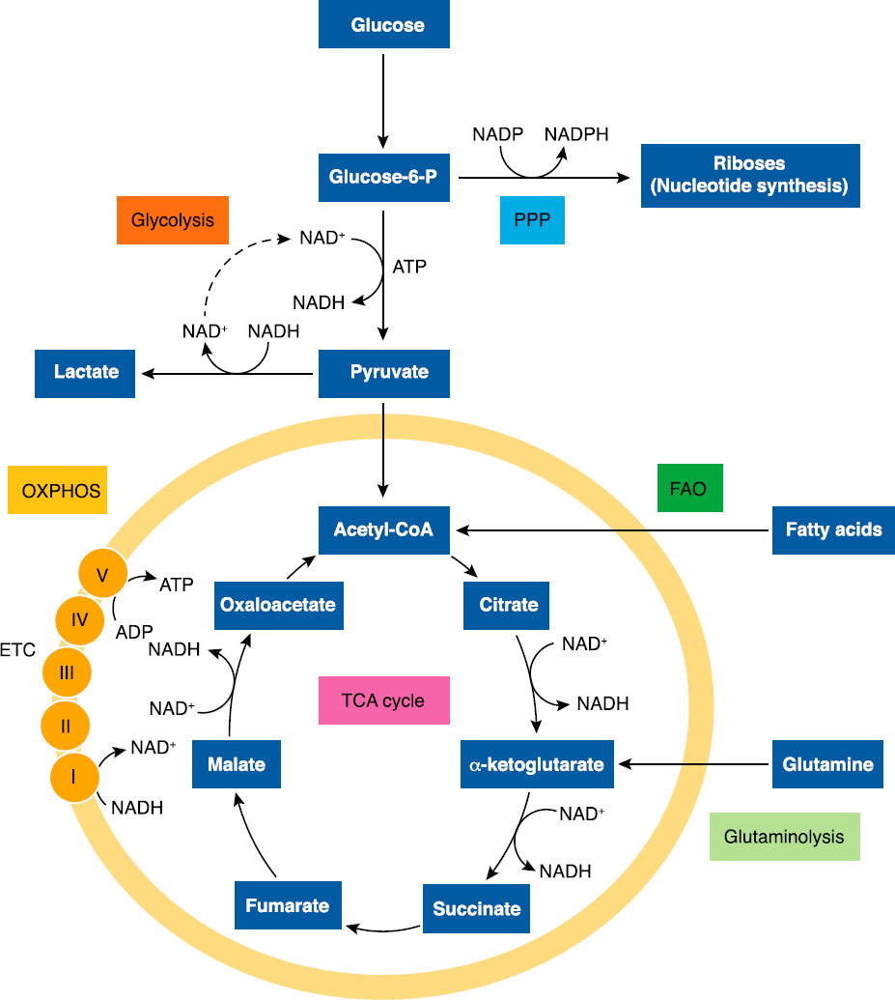
:::

# Berechnung Energie im Futter

```{r,echo=FALSE,warning = FALSE,results = 'asis'}
tab0 <- data.frame(Nutrient = c("Stärke",
                                "Fett",
                                "Faser",
                                "RP",
                                "ROM",
                                 "Asche"),
                   VE = c(17.7,
                          39.33,
                          17.6,
                          23.63,
                          16.73,0)) |> 
  gt(rowname_col = "Nutrient") |> 
  cols_label(VE = "VE Wert (MJ/kg)") |> 
  tab_footnote("ROM = Zucker, Fettsäuren, Glycerol, Lösliche Faser") 
tab0
```

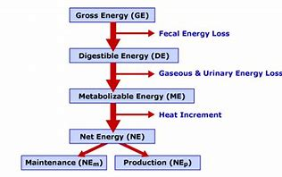{width="50%"}

# Eiweiss

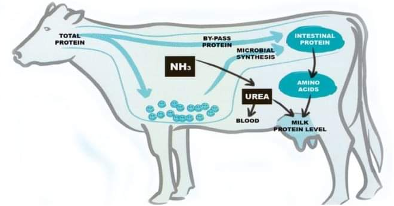

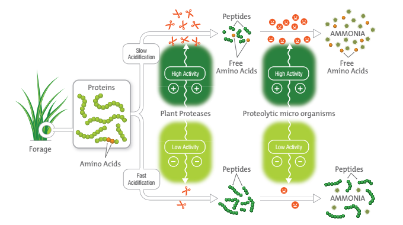

<br>

Stark verband Ammoniak-Biogene Amines, @jovaisiene2017

<br>

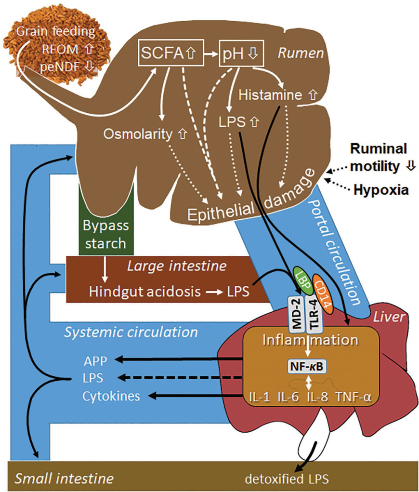
<div class="rf"> Quelle: @aschenbach2019 </div>

# Was brauchen wir:

**In Grasssilages**

-   Schnelle und Komplete Trocknung im Feld
-   Schnelle Ansäuerung im Silo
-   Wenig Rohasche/Sand
-   Gute Inhaltstoffen
-   Wenig Verlüste im Silo und nach Aussilieren

**In Maissilage**

-   Gute Erträge und Qualität
-   Gute bearbeitung Körner
-   Schnelle Ansauerung im Silo
-   Wenig Verlüste Im Silo und nach Aussilieren

# Faser

**Kuhe brauchen auch Faser**

::: {style="display: flex; align-items: center; gap: 50px;"}
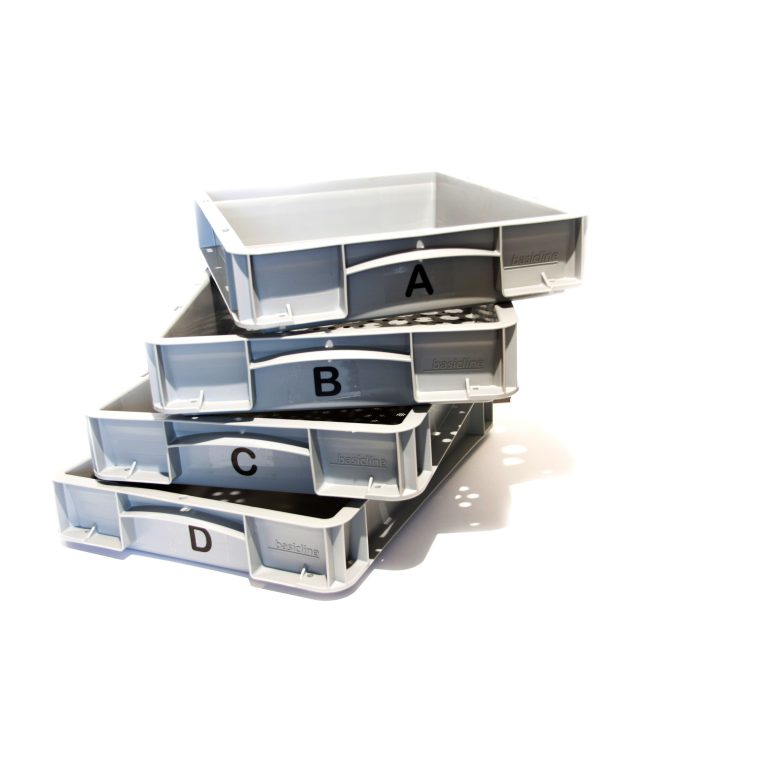 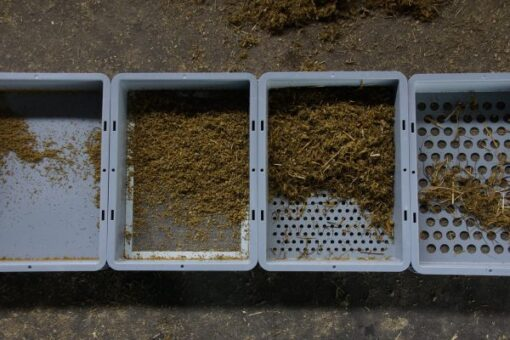
:::

**Zielwerten und Ergebnisse**

```{r,echo=FALSE,results='asis'}
tab <- read.xlsx("beelden/20250417_tabellen.xlsx",
                   sheet = "tabschudbox",
                   colNames = TRUE)
tab |> gt(id="two",rowname_col = "X1") |> 
  cols_label(X1 = "")

tab2 <- data.frame(Futter = c("Mais",
                              "Grass",
                              "Kraffutter",
                              "Gesamt"),
                   Anteil = c(56,
                              14.4,
                               28.6,NA),
                   PL = c(3,29,0,6))
tab2 |> gt(id = "three",
           rowname_col = "Futter") |> 
  cols_label(PL = "% >19mm") |> 
  sub_missing(missing_text = "")
                   
```

::: rf
Quelle: <https://extension.psu.edu/penn-state-particle-separator>
:::

# Maiskörner

::: {style="display: flex; align-items: center; gap: 50px;"}
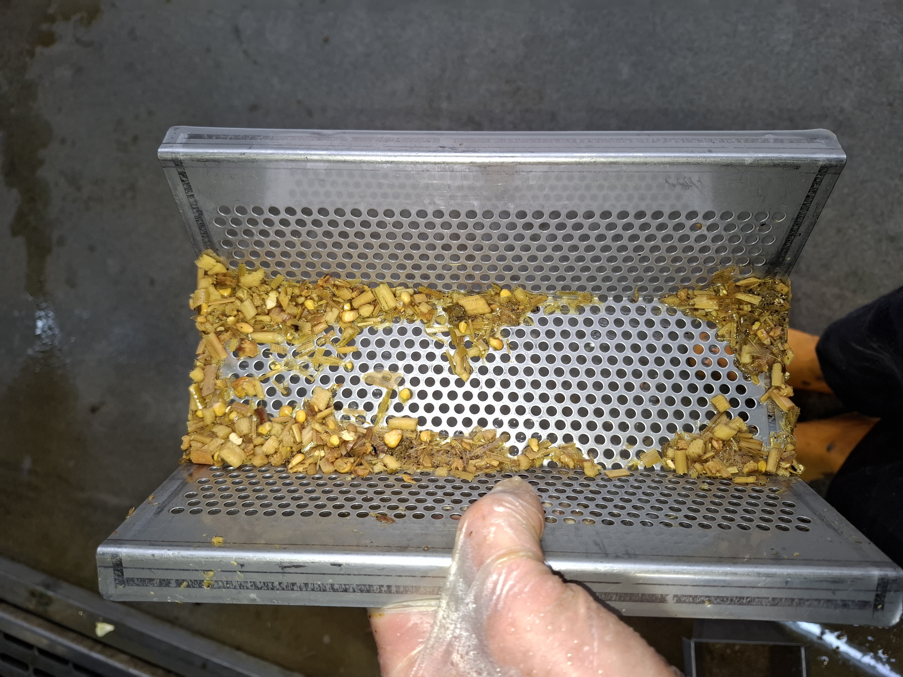 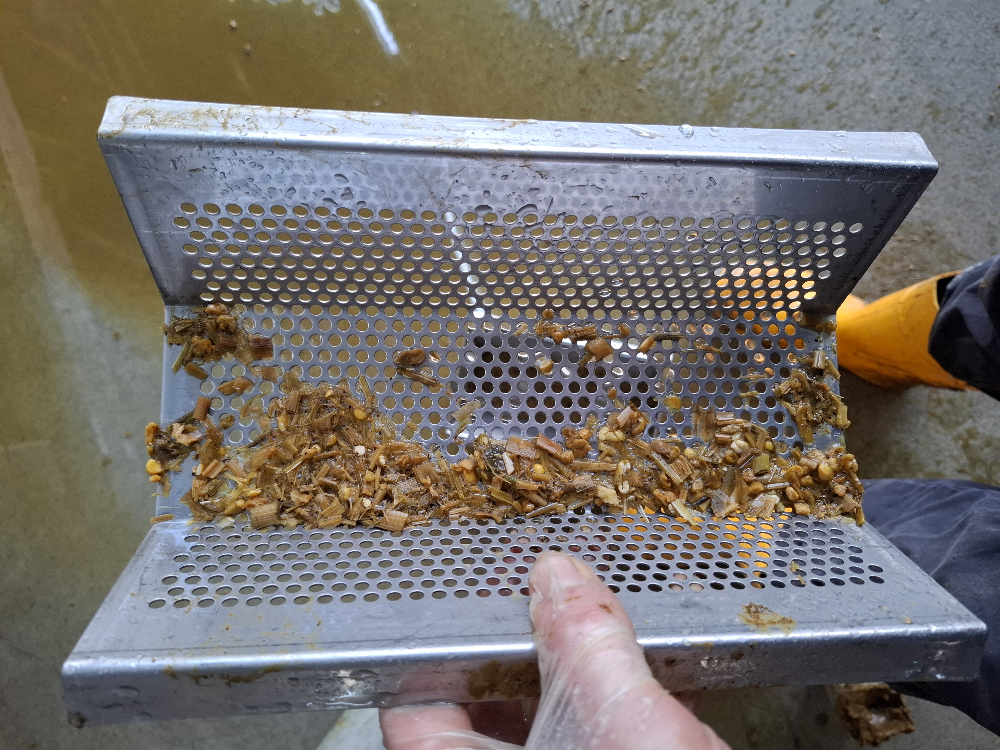
:::

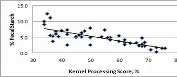{width="60%"}

::: rf
Quelle: <https://en.engormix.com/feed-machinery/silage-forage/effect-corn-silage-kernel_a39557>
:::

**Analyse Mais Silo 10**

<iframe src="beelden/2024maissilo10.PDF" width="800px" height="1000px">

</iframe>

**Analyse Mais Silo 6**

<iframe src="beelden/2024maissilo6.PDF" width="800px" height="1000px">

</iframe>

**Analyse LKS Silo 10** <iframe src="beelden/2024lkssilo10.PDF" width="800px" height="1000px"></iframe>

# Ernte. Ziel: schnelle trocknung

```{r,echo=FALSE,results='asis'}
tabc <- read.xlsx("beelden/20250402_tabellen.xlsx",
                   sheet = "tab1cavallarin2005",
                   colNames = FALSE)

rc <- function(x){
  round(as.numeric(str_trim(gsub("[a-z]","",x))),2)
}

tabc |> 
  mutate(across(colnames(tabc)[-1],rc)) |> 
  gt(id="three",rowname_col = "X1") |> 
  tab_stubhead(label = "Zahl") |> 
  tab_header(title = "Enfluß quetschen und trocknung auf Sainfoin.") |> 
  tab_spanner(label = "ungequetsch",columns  = c(X3:X5)) |> 
  tab_spanner(label = "gequetsch",columns  = c(X6:X8)) |> 
  cols_label(X2 = "0",
             X3 = "25",
             X4 = "71",
             X5 = "77",
             X6 = "5",
             X7 = "25",
             X8 = "29") |> 
  opt_css(
    css = "
    .cell-output-display {
      overflow-x: unset !important;
    }
    div#two {
      overflow-x: unset !important;
      overflow-y: unset !important;
    }
    #two .gt_col_heading {
      position: sticky !important;
      top: 0 !important;
    }
    ")
```
<div class="rf"> Quelle: @Cavallarin2005 </div>

- Geschwindigkeit trocknung macht Qualität
- Geschwindigkeit trocknung vielleicht wichter als TS


# Ernte. Schnelle Konservierung

Silage verliert Qualität bis die pH stabil (niedrig) ist. Wichtig ist wie schnell diese niedrige pH wert errecht wert. Passiert nun wenn die Silage frei von Sauerstoff ist.

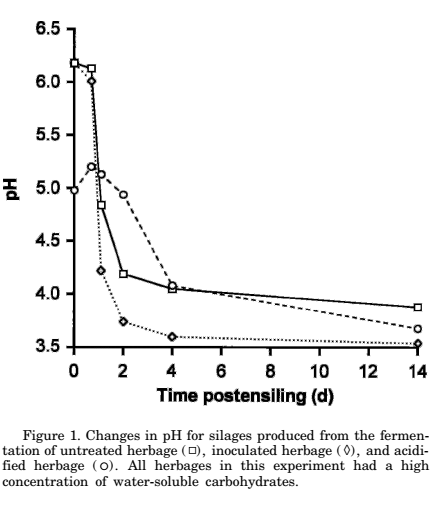
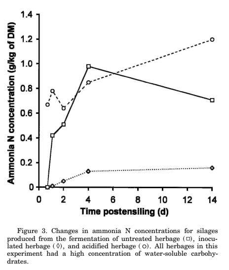

```{r,echo=FALSE,results='asis'}
tabd <- read.xlsx("beelden/20250402_tabellen.xlsx",
                   sheet = "tab2davies1998",
                   colNames = TRUE)

tabd |> 
  gt(id="six",rowname_col = "Wert") |> 
  tab_footnote("Buchstaben zeichen Stat. Relevanz")
```

<div class="rf">Quelle: @Davies1998 </div>

# Ernte: Häckseln und verdichtung

```{r,echo=FALSE,results='asis'}
tabp <- read.xlsx("beelden/20250402_tabellen.xlsx",
                   sheet = "tab3pauly1999",
                   colNames = TRUE)

tabp |>
  select(-Forage.treatment) |> 
  gt(id="seven",rowname_col = "Dichtheit") |> 
    tab_header("Einfluß Technik und Verdichtung auf Silagequalität.") |> 
  tab_row_group("Ladewagen 26 cm",rows = 1:2) |> 
  tab_row_group("Ladewagen 4 cm",rows = 3:4) |> 
  tab_row_group("Häcksler 4 cm",rows = 5:6) 
```

<div class="rf">Quelle: @Pauly1999</div>

# Ernte: Siliermittel


<div class="rf">Bron: @Davies1998</div>

```{r,echo=FALSE,results='asis'}
tablk <- read.xlsx("beelden/20250402_tabellen.xlsx",
                   sheet = "tab2kristensen2010",
                   colNames = FALSE)

tablk |>
  mutate(across(colnames(tablk)[-1],rc)) |> 
  gt(id="eleven",rowname_col = "X1") |> 
  tab_header("Maissilages mit 3 Siliermitteln") |> 
  tab_spanner(label = "January",columns  = c(X2,X4)) |> 
  tab_spanner(label = "April",columns  = c(X5,X7)) |> 
  tab_spanner(label = "August",columns  = c(X8,X10)) |>
  sub_missing(columns = everything(),missing_text = "") |> 
  cols_label(X2 = "Control",
             X3 = "Lactsil",
             X4 = "Lactisil Fresh",
             X5 = "Control",
             X6 = "Lactsil",
             X7 = "Lactisil Fresh",
             X8 = "Control",
             X9 = "Lactsil",
             X10 = "Lactisil Fresh") |> 
  opt_css(
    css = "
    .cell-output-display {
      overflow-x: unset !important;
    }
    div#eleven {
      overflow-x: unset !important;
      overflow-y: unset !important;
    }
    #eleven .gt_col_heading {
      position: sticky !important;
      top: 0 !important;
    }
    ")
```

<div class="rf">Quelle: @Kristensen2010</div>

- Homofermentative Siliermittel für (Eiweiß)qualität
- Heterofermentative Mitteln gegen erwärmung. Kosten Qualität

# Ernte: Grass in Schwierige Bedingungen

```{r,echo=FALSE,results='asis'}
tabpiep <- read.xlsx("beelden/20250402_tabellen.xlsx",
                   sheet = "table1pieper2009",
                   colNames =TRUE)

tabpiep |>
  select(-2) |> 
  mutate(across(colnames(tabpiep)[-(1:2)],rc)) |> 
  gt(id="twelve",rowname_col = "X1") |> 
  tab_header("Ausgangsmaterial.")
```

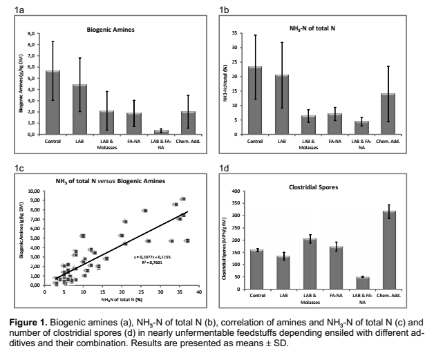

<div class="rf">Bron: @pieper2009</div>

hier filmpjes van gras +  maismengsel
-- 
--  
--  
-- 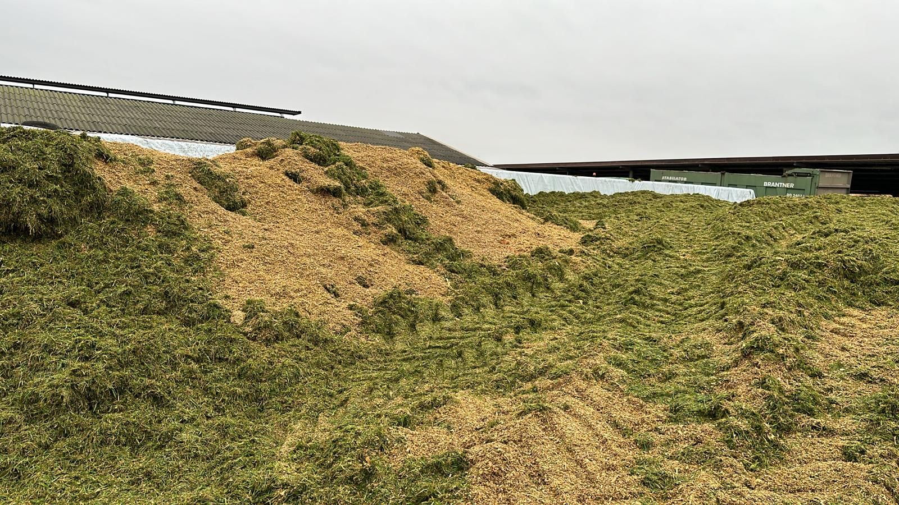 

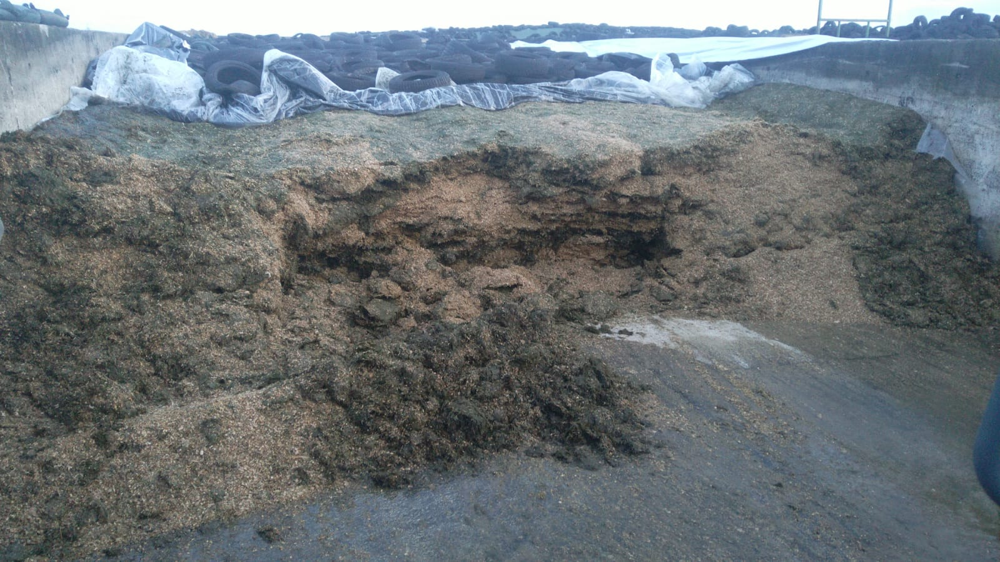


# Abdecken Silage

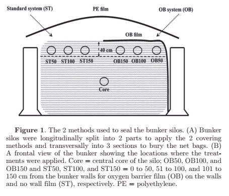

```{r,echo=FALSE,results='asis'}
tabl1 <- read.xlsx("beelden/20250417_tabellen.xlsx",
                   sheet = "tab1lima2017",
                   colNames = TRUE)

tabl1 |>
  gt(id="eight",rowname_col = "Item") |> 
    tab_header("Eigenschaften Abdeckfolie.")


tabl3 <- read.xlsx("beelden/20250417_tabellen.xlsx",
                   sheet = "tab3lima2017",
                   colNames = TRUE) 

tabl3 |> gt(id = "nine",rowname_col = 'item') |> 
  tab_header("Fermentation der Silage.")

tabl4 <- read.xlsx("beelden/20250417_tabellen.xlsx",,
                   sheet = "tab4lima2017",
                   colNames = TRUE)

tabl4 |> gt(id = "ten",rowname_col = 'item') |> 
  tab_header("Futterwert der Silage.") 

```

::: rf
Quelle: @Lima2017
:::

**Ziel Abdecken**

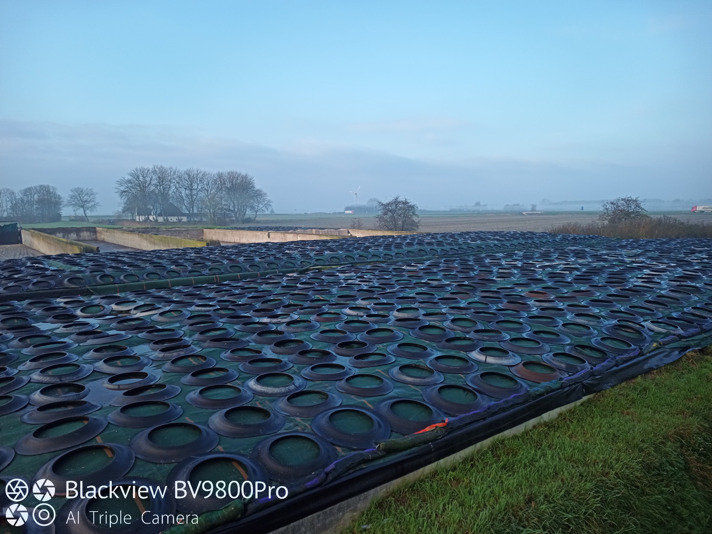{width="60%"}

# Ergebnisse Grass

**Grass Silo 11 2025**

<iframe src="beelden/2025_grasss11LA.PDF" width="800px" height="1000px">

</iframe>

**Grass BGA 2023**

<iframe src="beelden/2023_grass_bga.PDF" width="800px" height="1000px">

</iframe>

**Luzerne Silo 1 2024**

<iframe src="beelden/2024_luzerne_s1_LA.PDF" width="800px" height="1000px">

</iframe>

**Luzerne Silo 10 2024**

<iframe src="beelden/2024_luzerne_s10_LA.PDF" width="800px" height="1000px">

</iframe>

**Grass Mais Silo 13 2023**

<iframe src="beelden/2023_grass_silo_13_LA.PDF" width="800px" height="1000px">

</iframe>

# Maissilage

-   Silage besser abdecken, ziel weniger erwärmung nach öffnen
-   Körnerbearbeitung beobachten/verbessern

# Grassilage

-   Häckseln mit 5 cm länge
-   Mit Nasse Silage: immer Mais oder etwas anderes einmischen

# Einige Bilder

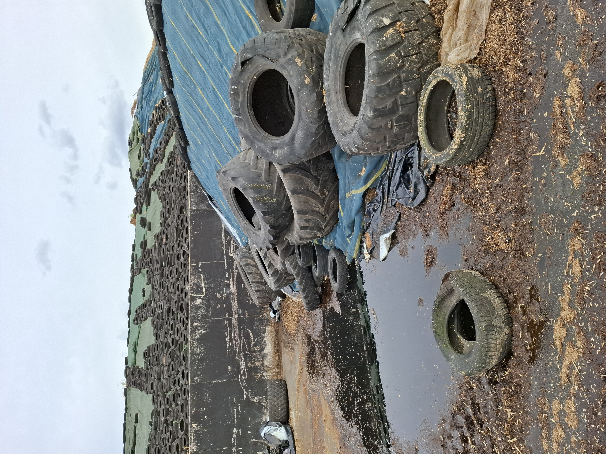{width="50%"}
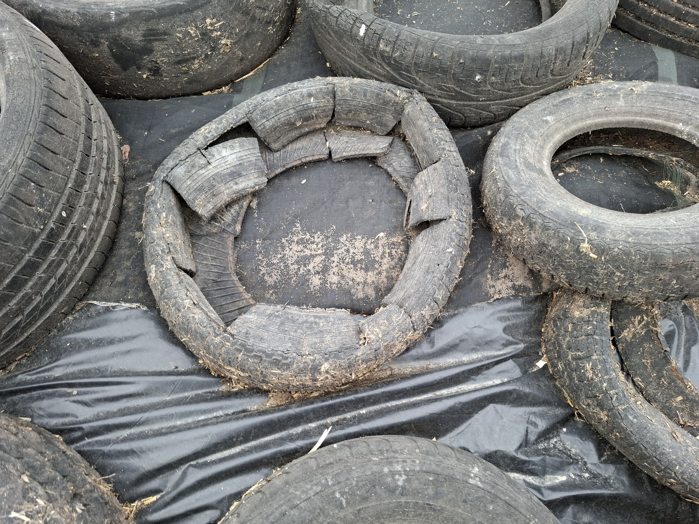{width="50%"}
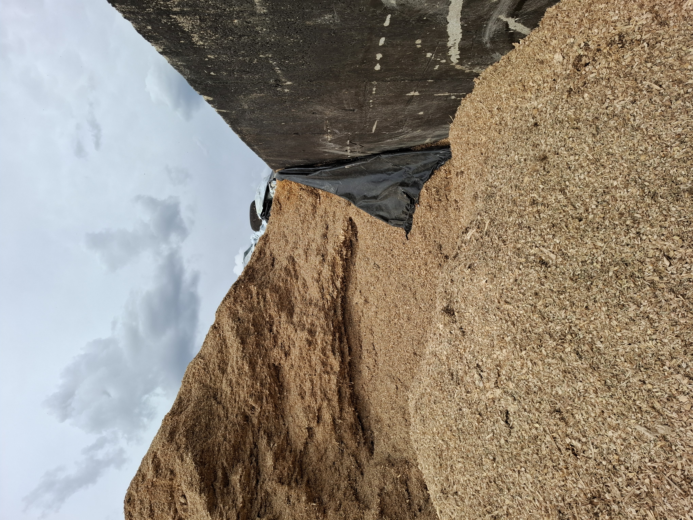{width="50%"}
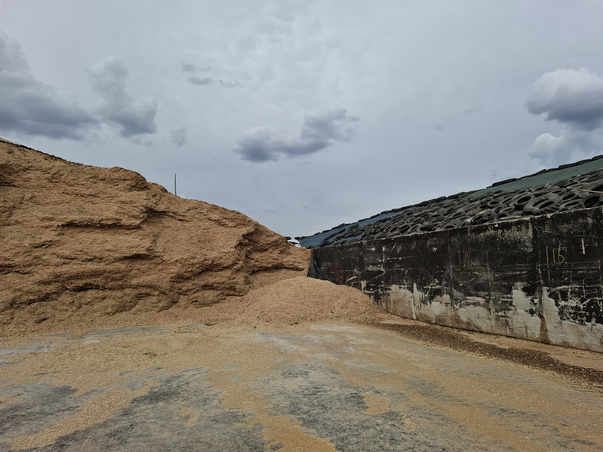{width="50%"}
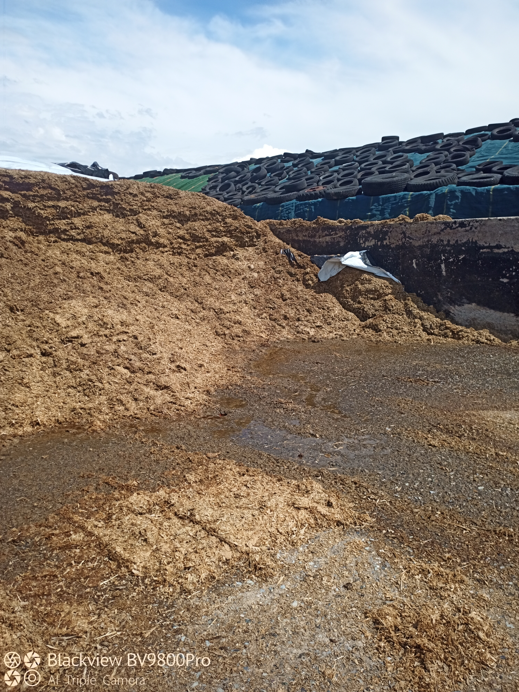{width="50%"}

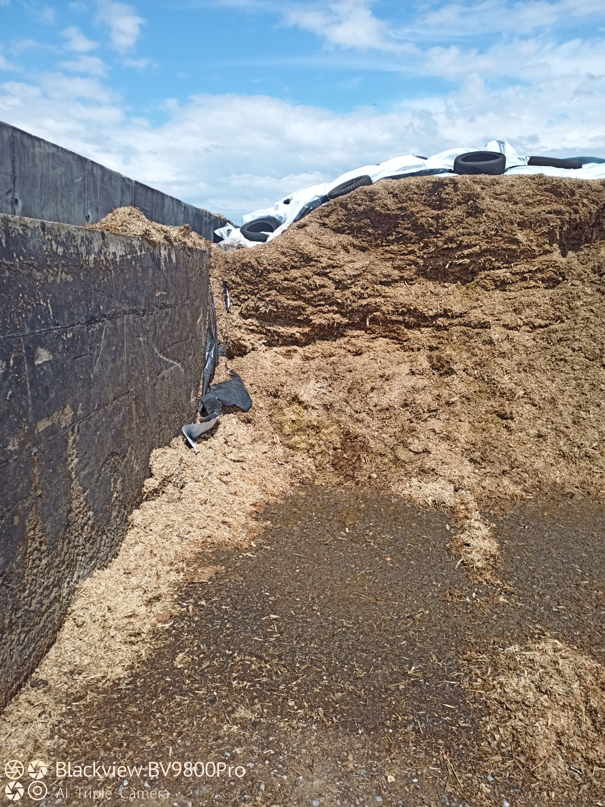{width="50%"}

# Eure gedanken

# Quellen

